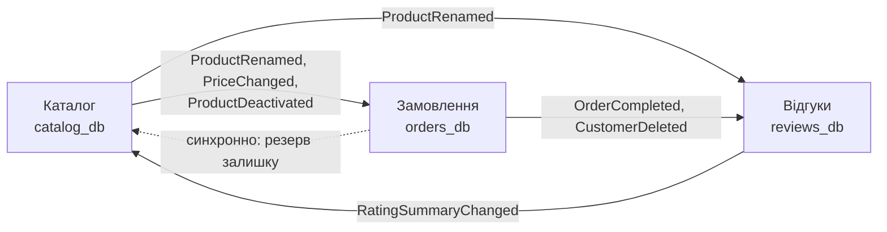
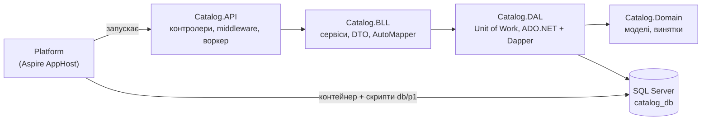

# Інтернет-пекарня/кондитерська: проєктування персистентності

Навчальний проєкт: три незалежні контексти, кожен зі своєю БД і своєю технологією доступу до даних.

## Структура репозиторію

```text
├── README.md    опис домену, запуск, розгортання БД, таблиця дублювання
├── docs/        ERD-діаграми, опис контекстів, приклади документів
│   ├── erd.md                 ERD трьох контекстів (Mermaid) і карта контекстів
│   ├── contexts.md            опис контекстів, агрегати, життєвий цикл, взаємодія
│   └── mongo-documents.md     приклади документів MongoDB, індекси, типові операції
├── Platform/    рішення .NET: Aspire AppHost + «Каталог» (API → BLL → DAL → Domain)
└── db/          SQL- і MongoDB-скрипти
    ├── p1/      Проєкт №1 (Каталог): schema.sql · procedures.sql · seed.sql
    ├── p2/      Проєкт №2 (Замовлення): schema.sql · seed.sql
    └── p3/      Проєкт №3 (Відгуки, MongoDB): collections.js · seed.js
```

Запуск застосунку «Каталог»: [розділ 10](#10-застосунок-каталог-проєкт-1-архітектура-запуск-запити).

Документація: [ERD](docs/erd.md) · [опис контекстів](docs/contexts.md) · [приклади документів MongoDB](docs/mongo-documents.md).

## 1. Опис домену

Інтернет-пекарня/кондитерська — це вебсистема, якою користуються **покупці** (замовляють випічку, торти та десерти з доставкою або самовивозом), **персонал** пекарні (керує асортиментом, цінами та виконанням замовлень) і **адміністратори**. Система показує актуальний каталог товарів, приймає й обробляє замовлення та збирає відгуки покупців, щоб бізнес міг продавати без ручної обробки заявок і покращувати якість продукції.

## 2. Контексти та технології

| Контекст | Відповідальність | БД | Технологія | Скрипти |
|---|---|---|---|---|
| **Каталог** (Проєкт №1) | Що пекарня продає: товари, варіанти, ціни, алергени, залишки | `catalog_db` (SQL Server) | ADO.NET + Dapper, збережувані процедури | `db/p1/` |
| **Замовлення** (Проєкт №2) | Покупка: клієнти, кошик, замовлення, оплата, доставка, промокоди | `orders_db` (SQL Server) | EF Core, Code First, Fluent API, міграції | `db/p2/` (еталонна схема) |
| **Відгуки** (Проєкт №3) | Оцінки, коментарі, модерація, рейтинг | `reviews_db` (MongoDB) | MongoDB, документи-агрегати | `db/p3/` |

Міжконтекстних зовнішніх ключів немає. Контексти посилаються один на одного лише ідентифікаторами та знімками полів, а синхронізуються подіями.



## 3. Сутності та агрегати

Усього 20 сутностей, кожна належить рівно одному контексту.

| Контекст | Агрегат (корінь + склад) | Примітка |
|---|---|---|
| Каталог | **Product** = Product + ProductVariant (+ зв'язки з Ingredient, Allergen) | Варіанти не існують без товару |
| Каталог | **Category**, **Ingredient**, **Allergen** | Довідники |
| Каталог | **StockItem** (+ технічна таблиця резервів) | Окремий агрегат: змінюється постійно |
| Замовлення | **Customer** = Customer + Address | |
| Замовлення | **Cart** = Cart + CartItem | Тимчасовий |
| Замовлення | **Order** = Order + OrderItem + Delivery | Після оформлення позиції не змінюються |
| Замовлення | **Payment**, **PromoCode** | Власний життєвий цикл |
| Відгуки | **Review** = Review + ReviewPhoto + ReviewReply (вбудовані) | Один документ |
| Відгуки | **ReviewReport**, **ProductRatingSummary** | Окремі колекції |

Службові структури (не входять у 20 сутностей): `OutboxMessages`, `InboxMessages`, `StockReservations`, `ProductRefs`/`VariantRefs`, `ProductRatings`, `PromoCodeUsages`, колекція `reviewEligibility`.

## 4. Запуск і розгортання БД

### Вимоги

- SQL Server 2019+ (скрипти на T-SQL; потрібні `STRING_AGG`, `CREATE OR ALTER`, `THROW`)
- MongoDB 6+ та `mongosh`
- `sqlcmd` (або будь-який клієнт SQL Server)

### Розгортання (з кореня репозиторію)

```bash
SQL="sqlcmd -S localhost,1433 -U sa -C -f 65001 -b"

# Проєкт №1 — Каталог: схема → процедури → демо-дані
$SQL -i db/p1/schema.sql
$SQL -i db/p1/procedures.sql
$SQL -i db/p1/seed.sql

# Проєкт №2 — Замовлення: схема → демо-дані
$SQL -i db/p2/schema.sql
$SQL -i db/p2/seed.sql

# Проєкт №3 — Відгуки (MongoDB): колекції та індекси → демо-дані
mongosh "mongodb://localhost:27017" db/p3/collections.js
mongosh "mongodb://localhost:27017" db/p3/seed.js
```

Порядок важливий: у кожному проєкті спочатку схема, потім решта. Між проєктами залежностей під час розгортання немає: БД незалежні.

### Примітки

- Прапорець `-f 65001` потрібен, бо скрипти містять кирилицю в UTF-8; `-b` зупиняє виконання на першій помилці.
- `schema.sql` (обидва SQL-проєкти) і `db/p3/collections.js` призначені для **порожніх** БД. Файли `seed.sql` і `db/p3/seed.js` можна запускати повторно: вони спершу очищають дані у своїх таблицях/колекціях (структура, валідатори й індекси лишаються). Не запускайте їх на БД із реальними даними. Для перезапуску видаліть БД (`DROP DATABASE catalog_db;`, `DROP DATABASE orders_db;`, а в `reviews_db` виконайте `db.dropDatabase()`).
- **Демонстраційні дані узгоджені між БД.** Усі три `seed`-файли використовують спільні ідентифікатори: ті самі товари й варіанти в Каталозі та в `ProductRefs` / `VariantRefs` Замовлень, ті самі клієнти й позиції замовлень у Замовленнях і Відгуках. Рейтинг «Медовика» у Відгуках збігається з копією `ProductRatings` у Каталозі.
- У Проєкті №2 схема в реальному коді створюється **міграціями EF Core**:
  ```bash
  dotnet ef migrations add Initial
  dotnet ef database update
  ```
  Fluent API має відтворювати `db/p2/schema.sql` (кластеризований індекс `OrderItems`, фільтровані індекси, `CHECK`-обмеження, `OnDelete`, `IsRowVersion`). Сам скрипт потрібен для рев'ю та порівняння.
- Перевірка після розгортання: `SELECT * FROM dbo.vw_ProductListing;` у `catalog_db`, `SELECT * FROM dbo.vw_OrderSummary;` в `orders_db`, `db.reviews.find()` у `reviews_db`.

## 5. Таблиця політики дублювання даних

Власник даних один. Інші контексти тримають ідентифікатор і, за потреби, знімок або копію. Оновлення йдуть **подіями через брокер** з Outbox-патерном у власника. Споживачі ідемпотентні (Inbox) і відкидають застарілі події за версією.

**Знімок** фіксує факт на момент події й ніколи не змінюється. **Копія** відображає поточний стан власника й оновлюється подіями.

| Поле | Де зберігається | Джерело (власник) | Політика узгодженості |
|---|---|---|---|
| `OrderItems.ProductName`, `VariantName`, `UnitPrice` | БД Замовлень | Product / ProductVariant (Каталог) | **Знімок** на момент оформлення, не оновлюється |
| `ProductRefs`: `Name`, `IsActive`; `VariantRefs`: `Name`, `Price`, `IsActive` (локальна копія довідника) | БД Замовлень | Product / ProductVariant (Каталог) | **Оновлюється подіями** `ProductRenamed`, `PriceChanged`, `ProductDeactivated`. Eventual consistency; застарілі події відкидаються за `SourceVersion` |
| `CartItems.ProductId`, `VariantId` | БД Замовлень | Product (Каталог) | Лише **ідентифікатор**. Якщо товар вимкнено, позиція кошика стає «недоступна» |
| `StockItems.QuantityAvailable` | **Не дублюється** | StockItem (Каталог) | Строга узгодженість: синхронний виклик резервування під час оформлення; не вдалося — замовлення не створюється |
| `Review.customerId` | БД Відгуків | Customer (Замовлення) | Лише **ідентифікатор** |
| `Review.customerDisplayName` | БД Відгуків | Customer (Замовлення) | **Знімок** на момент відгуку. Виняток: подія `CustomerDeleted` запускає анонімізацію |
| `reviewEligibility`: `customerId`, `productId`, `orderItemId` | БД Відгуків | Order / OrderItem (Замовлення) | **Оновлюється подією** `OrderCompleted`. Відгук можливий лише за наявності запису; один відгук на `orderItemId` |
| `Review.productId` | БД Відгуків | Product (Каталог) | Лише **ідентифікатор** |
| `Review.productName` | БД Відгуків | Product (Каталог) | **Оновлюється подією** `ProductRenamed` |
| `ProductRatings`: `AvgRating`, `ReviewCount` (копія `ProductRatingSummary`) | БД Каталогу | ProductRatingSummary (Відгуки) | **Оновлюється подією** `RatingSummaryChanged`. Eventual consistency; застарілі події відкидаються за `RatingVersion` |

Відгуки не потребують нічого з Замовлень понад наведене; Каталогу не потрібні дані із Замовлень.

## 6. Ключі, індекси, обмеження

- **Первинні ключі:** GUID для основних сутностей (id потрібен до `INSERT`, потрапляє в події й інші контексти). `BIGINT IDENTITY` лише для `OutboxMessages`. `OrderNumber` (BIGINT із `SEQUENCE`) окремо для людей. Репліки (`ProductRefs`, `VariantRefs`) беруть id власника.
- **Каскади:** `CASCADE` лише для залежних рядків без власної історії (`OrderItems`, `Deliveries`, `CartItems` тощо). Клієнта з історією не видаляють, а анонімізують; `Payments` не зникають разом із замовленням; варіант товару не видаляють фізично.
- **Індекси** прив'язані до запитів (покриваючі та фільтровані): `Status = 1` для списків товарів, `IsActive = 1` для цін варіантів, `Status = 0` для прострочених резервів. Індекси без запиту не створюються.
- **Обмеження:** `CHECK` на суми, статуси, формат телефону й email, узгодженість `Payments` (статус, дата оплати, сума повернення), інваріанти видалення.

Деталі та обґрунтування: коментарі в шапці `db/p1/schema.sql`, `db/p2/schema.sql`, `db/p3/collections.js`.

## 7. Аудит, м'яке видалення, конкурентність

| Механізм | Що зроблено |
|---|---|
| Аудит | `CreatedAt`, `CreatedBy`, `UpdatedAt`, `UpdatedBy` на кореневих сутностях. `*By` має формат `staff:<guid>`, `customer:<guid>` або `system:<сервіс>`. Заповнює застосунок, а не тригери |
| М'яке видалення | `IsDeleted` для Category, Product, ProductVariant, Ingredient, PromoCode, Review. Для Customer це похідне від `AnonymizedAt`. Замовлення та платежі не видаляються. Унікальність `Name` / `Slug` / `Sku` / `Code` забезпечують фільтровані індекси `WHERE IsDeleted = 0` |
| Оптимістична конкурентність (SQL) | `ROWVERSION` на рядках, які редагують люди: Product, ProductVariant, Customer, Cart, Order, Payment, PromoCode. Конфлікт повертається як HTTP 409 |
| Оптимістична конкурентність (Mongo) | Поле `version` у `reviews` і `reviewReports`: `updateOne({_id, version: N}, {..., $inc: {version: 1}})` |
| Без токена | `StockItems` і лічильник промокоду змінюються з кожним замовленням, тому використовують атомарний `UPDATE` з умовою. Колонки, які пише система (`ProductRatings`, `PromoCodeUsages`), винесено в окремі таблиці, щоб не викликати хибних конфліктів |

## 8. Події

| Джерело | Події |
|---|---|
| Каталог | `ProductCreated`, `ProductRenamed`, `PriceChanged`, `ProductDeactivated`, `StockChanged` |
| Замовлення | `OrderPlaced`, `OrderCancelled`, `OrderCompleted`, `CustomerDeleted` |
| Відгуки | `RatingSummaryChanged` |

Версія події для SQL-джерел: `CONVERT(BIGINT, RowVersion)` рядка-джерела.

## 9. Статус

- Проєкт №1 (Каталог) реалізований у `Platform/`: Web API, BLL, DAL (ADO.NET + Dapper), Aspire AppHost. Опис і запуск: розділ 10.
- Проєкти №2 (EF Core) і №3 (MongoDB) у цьому репозиторії поки що лише описані схемами, демо-даними й правилами узгодженості.
- SQL-скрипти Каталогу виконуються автоматично при старті AppHost, тож перший запуск через Aspire — це і є їхня перша перевірка на живому SQL Server. Скрипти Замовлень і MongoDB на живих серверах ще не запускалися. Перед використанням перевірте плани виконання ключових запитів (`SET STATISTICS IO` або Query Store).
- Відомий розбіг у демо-даних: `db/p2/seed.sql` (`ProductRefs`) використовує ідентифікатори товарів `b0000000-…`, а `db/p1/seed.sql` і `db/p3/seed.js` — `a0000000-…`. Для узгодженості між контекстами p2 треба привести до `a0000000-…`.

## 10. Застосунок «Каталог» (Проєкт №1): архітектура, запуск, запити

### Схема рішення



| Проєкт (папка) | Роль |
|---|---|
| `Platform/Platform` | Aspire AppHost: піднімає SQL Server, виконує `db/p1/*.sql`, запускає API і передає йому рядок підключення |
| `Platform/Catlog.API` | Тонкі контролери, `ExceptionHandlingMiddleware` (ProblemDetails), воркер очищення прострочених резервацій, Swagger |
| `Platform/Catlog.BLL` | Сервіси, DTO з DataAnnotations, профіль AutoMapper (`CatalogProfile`), доменні перевірки (`Check`) |
| `Platform/Catlog.DAL` | `IUnitOfWork` (одне з'єднання й транзакція), репозиторії: ADO.NET (`CategoryRepository`) і Dapper (`BaseDapperRepository<T>`) |
| `Platform/Catalog.Domain` | Моделі, enum-и, доменні винятки |

### Що потрібно для запуску

- .NET SDK 10;
- Docker Desktop (або сумісний контейнерний рантайм): Aspire запускає SQL Server в контейнері;
- `sqlcmd`, SQL Server і ручне розгортання БД з розділу 4 для цього шляху **не потрібні**.

### Запуск через Aspire

```bash
dotnet run --project Platform/Platform/Platform.csproj
# або з каталогу Platform/Platform:  aspire run
```

1. У консолі з'явиться посилання на Aspire Dashboard. Відкрийте його.
2. Дочекайтеся зеленого статусу ресурсів `sql`, `CatalogDb` і `catalog-api`. Перший старт довший: завантажується образ SQL Server і виконуються скрипти `schema.sql` → `procedures.sql` → `seed.sql`.
3. У Dashboard натисніть на endpoint `catalog-api` і додайте `/swagger` (Swagger UI працює в середовищі Development).

Порт API у Aspire динамічний: беріть його з Dashboard. Рядок підключення API отримує через `WithReference` (змінна `ConnectionStrings__CatalogDb`), вона перекриває значення з `appsettings.json`.

Контейнер SQL Server створюється заново при кожному запуску, тому дані повертаються до демо-стану. Щоб зберігати їх між запусками, додайте `.WithDataVolume()` разом із фіксованим паролем (`builder.AddParameter("sql-password", secret: true)` → `AddSqlServer("sql", password)`): з тимчасово згенерованим паролем том буде недоступний на наступному старті.

**Запуск API без Aspire.** Розгорніть БД за розділом 4, вкажіть свій рядок підключення в `Platform/Catlog.API/appsettings.json` (`ConnectionStrings:CatalogDb`) і виконайте `dotnet run --project Platform/Catlog.API` (за замовчуванням `http://localhost:5065`).

### Приклади запитів

Нижче `API` — адреса API (з Dashboard або `http://localhost:5065`). Ідентифікатори взято з `db/p1/seed.sql`. Те саме можна виконати в Swagger UI; для Postman імпортуйте `{API}/swagger/v1/swagger.json`.

```bash
API=http://localhost:5065

# Категорії
curl "$API/api/categories"
curl -X POST "$API/api/categories" -H "Content-Type: application/json" \
  -d '{"name":"Печиво","slug":"pechyvo","description":"Домашнє печиво","sortOrder":5}'   # 201 + Location

# Вітрина: фільтри, сортування (Newest | PriceAsc | PriceDesc | Rating), пагінація
curl "$API/api/products?categorySlug=torty&inStockOnly=true&sort=PriceAsc&page=1&pageSize=10"
curl "$API/api/products/top-rated?count=5"
curl "$API/api/products/by-slug/medovyk"

# Адмін-частина: товар з варіантами та rowVersion
curl "$API/api/products/a0000000-0000-4000-8000-000000000001"
curl -X POST "$API/api/products" -H "Content-Type: application/json" -d '{
  "categoryId": "c0000000-0000-4000-8000-000000000001",
  "name": "Червоний оксамит", "slug": "chervonyi-oksamyt",
  "description": "Бісквітний торт із крем-чізом", "basePrice": 700,
  "weightGrams": 1200, "shelfLifeHours": 72,
  "ingredientIds": ["a0000000-0000-4000-8000-000000000001"],
  "variants": [{"name": "1,2 кг", "sku": "RV-1200", "price": 700, "initialQuantity": 5, "dailyLimit": 8}]
}'
# Оновлення (PUT /api/products/{id}) вимагає "rowVersion" з останнього GET. Застарілий токен -> 409.

# Довідники
curl "$API/api/ingredients"
curl "$API/api/allergens"

# Залишки та резервування
curl "$API/api/stock/d0000000-0000-4000-8000-000000000001"
curl -X PUT "$API/api/stock/d0000000-0000-4000-8000-000000000001" -H "Content-Type: application/json" \
  -d '{"quantityAvailable":10,"dailyLimit":10}'
curl -X POST "$API/api/stock/reservations" -H "Content-Type: application/json" -d '{
  "orderId": "11111111-1111-4111-8111-111111111111", "ttlMinutes": 15,
  "lines": [{"variantId": "d0000000-0000-4000-8000-000000000001", "quantity": 2}]
}'                                                                                   # все або нічого; 409, якщо не вистачає
curl -X POST   "$API/api/stock/reservations/11111111-1111-4111-8111-111111111111/commit"   # 204
curl -X DELETE "$API/api/stock/reservations/11111111-1111-4111-8111-111111111111"          # звільнити

# Обслуговування (зазвичай викликає планувальник)
curl -X POST "$API/api/stock/maintenance/release-expired"
curl -X POST "$API/api/stock/maintenance/reset-daily"

# Inbox: імітація події RatingSummaryChanged із контексту «Відгуки»
curl -X POST "$API/api/events/rating-summary-changed" -H "Content-Type: application/json" \
  -d '{"eventId":"22222222-2222-4222-8222-222222222222","productId":"a0000000-0000-4000-8000-000000000001","avgRating":4.5,"reviewCount":13,"version":13}'
```

### Формат помилок

Усі помилки повертаються як `application/problem+json`:

| Статус | Коли |
|---|---|
| 400 | порушено DataAnnotations на DTO (`errors` по полях) або доменна `ValidationException` з BLL |
| 404 | `NotFoundException`: категорію, товар, варіант чи резервацію не знайдено |
| 409 | `ConflictException` (дублікат slug / SKU), `ConcurrencyException` (застарілий `rowVersion`), `InsufficientStockException` |
| 500 | неочікувана помилка (деталі лише в лозі) |

Приклад: `POST /api/categories` з `{"name":"","slug":"Bad Slug"}` повертає 400 з повідомленнями для полів `Name` і `Slug`.
